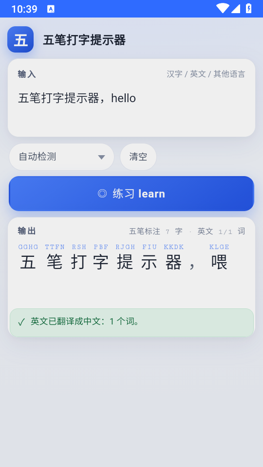
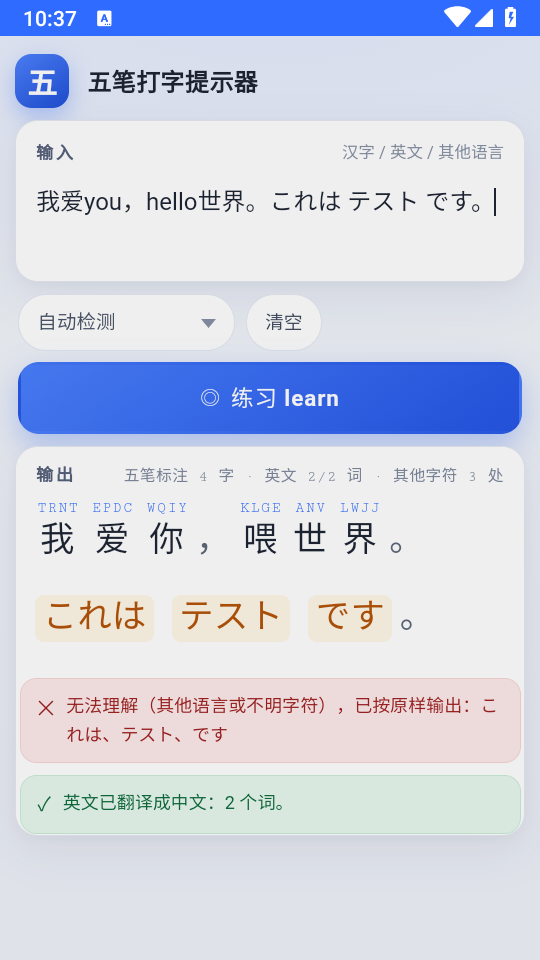
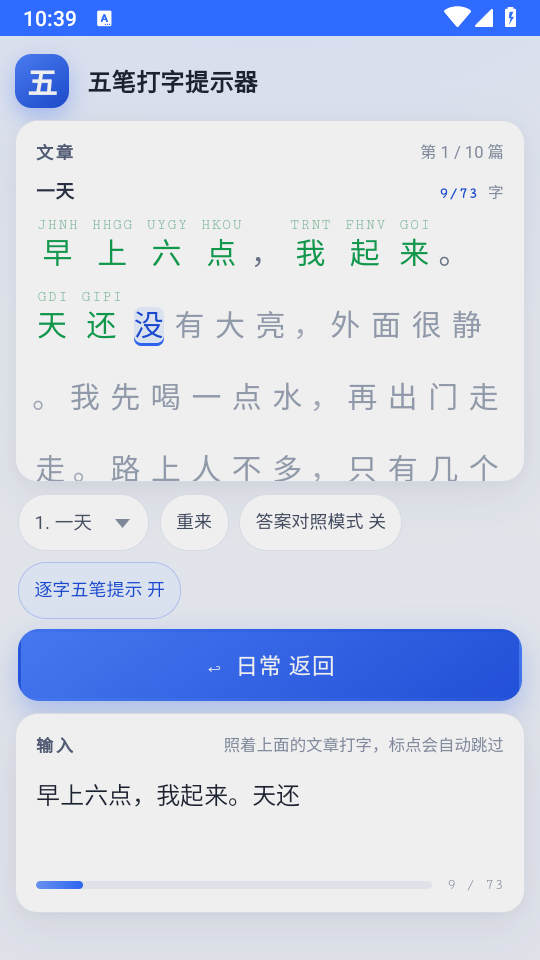
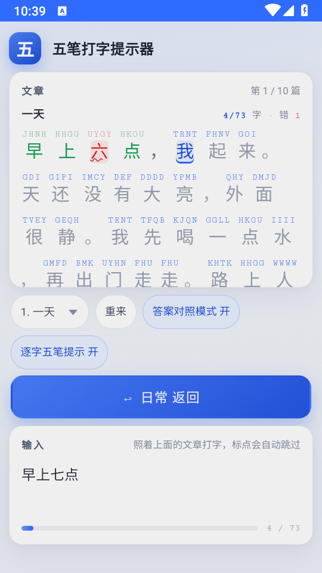
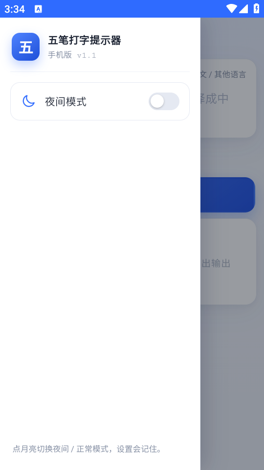
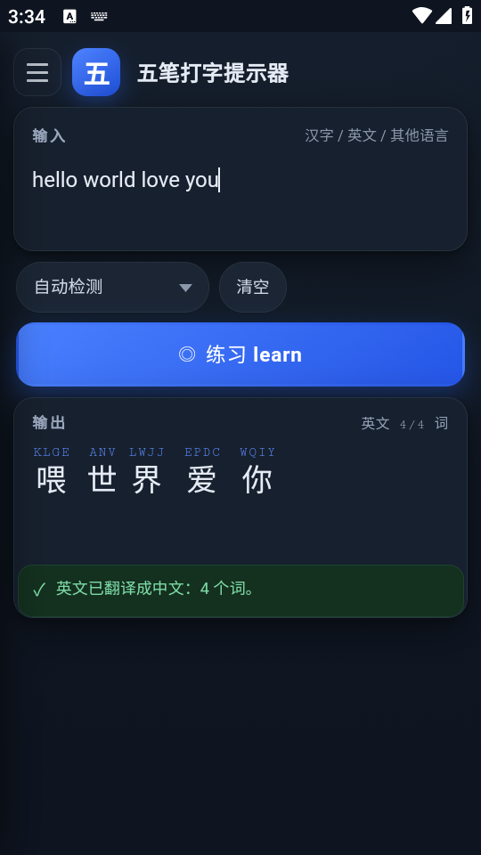
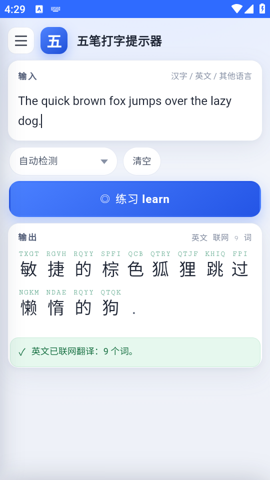

# 五笔打字提示器

> 上面输入，下面输出：汉字在上方标注五笔字母，英文翻译成中文，不认识的语言原样输出并提示。
> 按一下 **learn** 切换成「常用千字十篇」的逐字打字练习。

纯前端实现，**完全离线可用**，双击 `index.html` 即可运行；另附一个 Android APK 版本（同一个网页 + WebView 壳）。

---

## 特性

| 能力 | 说明 |
| --- | --- |
| 五笔标注 | 20,910 个汉字，单字取**全码**（如 `我 → TRNT`），字母显示在汉字正上方 |
| 英译中 | 离线词典 41,969 词 + 508 条功能词/短语修正表；可选接百度翻译 API 联网增强 |
| 中译英 | 反查词典 46,898 词 + 70 条高频固定译法（实验功能） |
| 其他语言 | 日文、韩文等原样输出，并提示「无法理解」 |
| 混排 | 中/英/不明字符各按各的规则处理，互不影响 |
| 练习模式 | 十篇由常用 1000 字写成的短文，逐字比对、错字标红、进度统计 |
| 答案对照 | 一键让全篇显示五笔码，方便对着打 |
| 夜间模式 | 手机版支持，设置会记住 |
| 额度管理 | 联网翻译可设每月字符上限，达上限自动关闭并回退离线 |

---

## 两个形态

### 电脑版（`pc/`）

```
双击 pc/index.html → 用浏览器打开即可，无需安装任何东西
```

### 手机版（`phone/`）

```
直接安装 phone/dist/wubi-dazi-tishiqi.apk（Android 5.0+）
```

源码在 `phone/`，用 `python build.py` 一条命令重新打包（不需要 Android Studio / Gradle）。

---

## 目录结构

```
.
├── pc/                        电脑版（双击即用）
│   ├── index.html
│   ├── README.md              电脑版详细说明（资源包格式写得很细）
│   ├── assets/                app.css / app.js
│   └── resources/             五类离线资源包
│       ├── wubi/wubi86.js             五笔 86 单字全码，20,910 字
│       ├── chinese/common1000.js      常用 1000 字
│       ├── chinese/common1000.txt     同上，纯文本备份
│       ├── english/ecdict_en2cn.js    英汉词典，41,969 词
│       ├── english/ecdict_cn2en.js    汉英反查，46,898 词
│       ├── english/fix_en.js          英译修正表，508 条
│       └── articles/articles.js       常用千字十篇文章
│
├── phone/                     手机版
│   ├── README.md              手机版详细说明（安装/打包/验收表/更新记录）
│   ├── build.py               一键打包 APK
│   ├── check_apk.py           打包后逐条核对 APK 内容
│   ├── dist/wubi-dazi-tishiqi.apk     成品
│   ├── www/                   网页部分（与 pc/ 基本一致 + 移动端增强）
│   └── android/               原生壳（WebView + 一个 Activity + 7 个辅助类）
│
└── docs/
    ├── dev-guide.pdf          开发流程与要点（9 页）
    ├── dev-guide.docx         同上，可编辑源文件
    └── screenshots/           25 张功能截图
```

---

## 资源包：改文件即生效

所有数据都是**普通 JS 文件**，通过 `window.registerXxx({...})` 注册，浏览器 `<script>` 加载。
要换词表、加文章，改对应 `.js` 文件 → 刷新页面，**不用重新编译**。

```js
// resources/english/fix_en.js 示例
window.registerFixEn({
  id: "fix-en", name: "英译修正表", version: "1.0",
  data: `# 冠词与功能词
the=
a=
an=
over=越过
will=将
# 短语（最长优先）
look forward to=期待
go to bed=睡觉`
});
```

---

## 截图

| 日常模式 | 中英日混排 |
| --- | --- |
|  |  |

| 练习模式逐字提示 | 答案对照模式 |
| --- | --- |
|  |  |

| 侧边栏 | 夜间模式 | 联网翻译 |
| --- | --- | --- |
|  |  |  |

更多截图见 `docs/screenshots/`。

---

## 开发文档

`docs/dev-guide.pdf`（9 页）记录了完整开发过程：

1. 需求解析与技术选型理由
2. 五类离线资源包怎么构建（含 ECDICT 清洗、字频融合）
3. 主程序结构、输入分流算法、练习状态机、45 条自检
4. 手机版为什么不用 Gradle、七步打包链、三层回退设计
5. **踩过的坑与修法**（正则提升、短语吞词、rAF 不执行、中文乱码、52003）
6. 验证方法、版本演进、可复用方法论

---

## 自检

页面带 `?selftest=1` 参数会跑 45 条断言并在页面顶部输出 PASS/FAIL 清单：

```
pc/index.html?selftest=1
```

手机版可用 adb 触发：

```bash
adb shell "am start -n com.wubi.hint/.MainActivity -e query '?selftest=1'"
adb logcat -s WubiHint
```

---

## 已知限制

- 离线英译是**逐词对译**，不处理语序与语法，长句读起来会像「电报体」；要流畅请开联网翻译
- 中译英（`zh2en`）为实验功能，只覆盖高频词
- 联网翻译需要自备百度翻译开放平台密钥（免费额度每月 5 万 / 100 万字符），密钥只存在本机，不进系统备份
- 手机版 APK 使用自签名证书，未上架任何应用商店

---

## 许可

MIT License，详见 [LICENSE](LICENSE)。

资源包数据来源：
- 五笔码表：[rime-wubi](https://github.com/rime/rime-wubi)（wubi86.dict.yaml）
- 字频：Jun Da 现代汉语字频表 + [jieba](https://github.com/fxsjy/jieba) 词频
- 词典：[ECDICT](https://github.com/skywind3000/ECDICT)
- 规范汉字表：[pinyin-data](https://github.com/mozillazg/pinyin-data)
